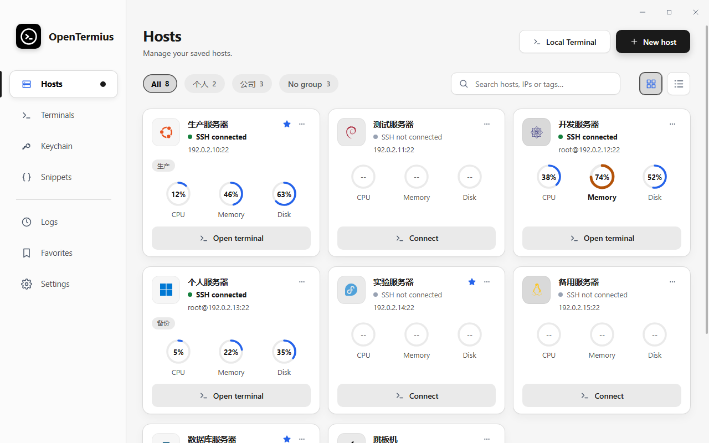
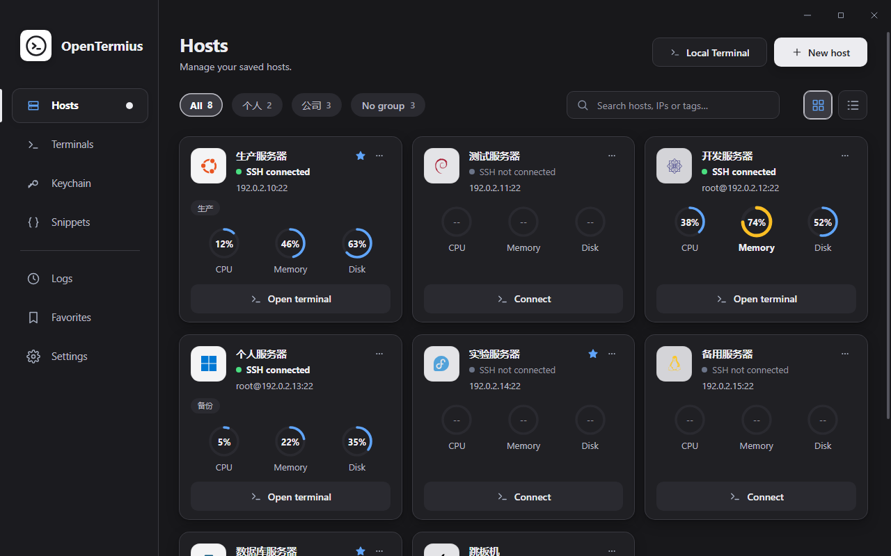
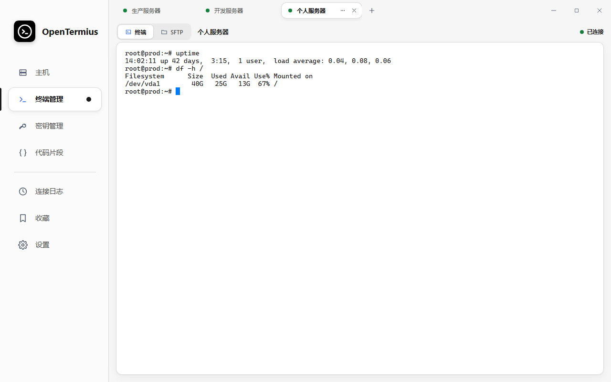

<p align="center"></p>

<h1 align="center">OpenTermius</h1>

<p align="center">A lightweight, local-first SSH &amp; SFTP desktop client.<br>Tauri 2 · React 19 · TypeScript · Rust. No account required.</p>

<p align="center"><a href="#english">English</a> · <a href="#中文">中文</a></p>

<p align="center"></p>

## English

OpenTermius keeps your hosts, keys and settings on your device, with no product account, subscription, cloud sync or telemetry. React renders the interface in the system webview; Rust owns SSH/SFTP, local terminals, persistence and credentials. The shipping executable embeds the built frontend, so Node.js and a development server are only needed for development.

### Features

- **Hosts**: groups, tags, favorites and search, plus `ssh user@host` quick connect from the search box. Grid and list views. Reorder hosts by dragging a card (or with Alt+Arrow keys). Each card shows the detected operating system, the SSH state (connected, not connected, connection lost) and live CPU, memory and disk usage while connected.
- **Terminals**: SSH and local PTY sessions in tabs, rendered with xterm.js. The Hosts page only manages hosts; open sessions and their tab strip live only under **Terminals**. On a connected host, **Open terminal** returns to its running session, and the host menu's **New session** opens another one. Tabs can be reconnected, duplicated and closed; closing the current tab moves to its neighbour. Terminal colours follow the app theme, and multi-line pastes always ask for confirmation.
- **SFTP**: a two-pane file view for every SSH session with upload, download, rename, new folder and delete. Transfers queue up to eight tasks and can be cancelled. Overwrites ask for confirmation, and hidden files can be shown.
- **Keychain**: generate keys or import existing private keys (with optional passphrase), copy or export public keys and see which hosts use each key.
- **Snippets**: save frequently used commands and paste them into the active terminal.
- **Logs**: connection history with filtering and **Connect again**.
- **Themes**: white background with black text, black background with white text, follow the system, or switch by time of day (light from 07:00 and dark from 19:00 by default, both adjustable).
- **Settings**: English, Simplified Chinese or the system language; keepalive and connection timeout; SFTP overwrite confirmation and hidden files; automatic update checks. The terminal font size, scrollback, cursor blink, copy-on-select, bell and colour-scheme preferences are saved but not yet applied by the terminal.
- **Import and backup**: import hosts from JSON, Xshell sessions or WindTerm `user.sessions`; export hosts without credentials; encrypted backup and restore with a recovery code.

Keyboard on the Hosts page: arrow keys move the selection, Enter connects (or opens the running terminal), Delete removes a host, Alt+Arrow moves it.

<p align="center"></p>

### Security and privacy

Host fingerprints are verified before connecting. Credentials stay in Rust and are encrypted locally: Windows DPAPI, macOS Keychain-backed encryption, and a private master-key file on Linux. The Linux master-key file is not protected by an OS keyring; keep it private and include it in configuration backups. Exported hosts omit credentials and trust records.

Network access is limited to your SSH/SFTP connections and the update check against this project's GitHub Releases (release metadata, `checksums.json` and the installer; nothing about you is sent). The Windows installer also contacts Microsoft when WebView2 has to be installed.

### Install

**Windows x64**: download `OpenTermius-<version>-windows-x64-setup.exe` and `checksums.json` from [Releases](https://github.com/noeigenstate/opentermius/releases) and compare the installer's SHA-256 with `checksums.json`. The installer is unsigned, so SmartScreen may warn.

The NSIS installer installs per user, creates shortcuts and upgrades the existing directory in place. It needs the Microsoft Edge **WebView2 Runtime**: setup detects per-machine and per-user installations and otherwise runs the bundled, Microsoft-signed Evergreen bootstrapper (internet required). For offline machines, preinstall the [Evergreen Standalone Installer](https://learn.microsoft.com/en-us/microsoft-edge/webview2/concepts/distribution#offline-deployment). If the runtime installation fails, setup stops before replacing application files.

Uninstall keeps your configuration by default. Tick the data-removal box (or pass `/REMOVEDATA` to a silent uninstall) to delete it.

In-app updates download the new installer only when its size and SHA-256 match the release's `checksums.json`, then run the silent upgrade. Copies that were not installed open the release page instead.

**macOS and Linux**: CI builds and tests both platforms, and `native/scripts/package-macos.sh` / `package-linux.sh` produce unsigned archives. No signed packages are published, and these platforms still need real desktop verification.

### Development

Prerequisites: Node.js 22, npm, stable Rust and the [Tauri platform dependencies](https://v2.tauri.app/start/prerequisites/). Windows needs Visual Studio C++ Build Tools and WebView2. macOS needs Xcode Command Line Tools. Linux packages (including WebKitGTK 4.1 and Ayatana AppIndicator) are listed in [CI](.github/workflows/ci.yml).

Start the frontend dev server (all platforms):

```sh
cd native/web
npm install
npm run dev
```

Then run the desktop shell in a second terminal (all platforms):

```sh
cd native
cargo run --locked -p opentermius-desktop
```

Alternatively, run the Tauri CLI from `native/desktop/`: `../web/node_modules/.bin/tauri dev` on macOS/Linux, or `../web/node_modules/.bin/tauri.cmd dev` in Windows PowerShell.

Run Cargo inside `native/` so its platform configuration is loaded, and keep one Cargo build running at a time.

### Tests

All platforms (tested on Windows 10; macOS and Linux run the same steps in CI):

```sh
cd native
node scripts/check-versions.mjs
node --test scripts/check-versions.test.mjs
cargo build --locked --workspace
cargo test --locked --workspace
cd web
npm run build
npm test
```

See [Tauri architecture](docs/tauri-architecture.md) for the layout and the command/event contract. Rust messages use `native/src/i18n_catalog.rs`; frontend Chinese translations live in `native/web/src/i18n/zh/`. Before changing code, read the matching guides in [`skills/`](skills/) (refactoring rules, desktop UI design, Windows validation). Old Slint screenshots and validation documents describe the previous UI, not the current app.

### Build and release

Windows (PowerShell), from the repository root with NSIS 3 installed:

```powershell
./native/scripts/package.ps1
```

The script runs `npm ci` and `npm run build` in `native/web/`, then this command in `native/`:

```sh
cargo build --release --locked -p opentermius-desktop --features tauri/custom-protocol
```

`tauri/custom-protocol` embeds `web/dist` into the executable; a plain release build does not. `native/installer/installer.nsi` packages `target/release/opentermius.exe` (honouring Cargo's configured target directory) into `native/releases/OpenTermius-<version>-windows-x64-setup.exe` and `checksums.json`. Tauri's own bundler stays disabled. See [packaging details](native/installer/README.md) for NSIS discovery, a cached bootstrapper and `-SkipBuild`.

The canonical version is `native/desktop/tauri.conf.json` (currently `0.8.0`). It must match both Cargo manifests, `Cargo.lock` and the web manifest and lockfile; packaging and CI enforce this. Pushing a matching `vX.Y.Z` tag runs the release workflow, which builds, verifies and publishes the installer and `checksums.json` in the format the updater reads. Silent upgrades use `installer /S /D=<install-dir>`, with `/D` last and unquoted.

`native/installer/verify-install.ps1` checks silent install, overwrite upgrade, shortcuts, registration, uninstall and configuration retention on a clean Windows account. It refuses to run over a real installation.

## 中文

OpenTermius 是轻量、本地优先的 SSH/SFTP 桌面客户端。主机、密钥和设置都保存在本机，无需产品账号、订阅或云同步，也不收集遥测。界面由 React 在系统 WebView 中渲染，Rust 负责 SSH/SFTP、本地终端、配置和凭据。发布程序内嵌编译后的前端，运行时无需 Node.js 或开发服务器。

<p align="center"></p>

### 功能

- **主机**：分组、标签、收藏和搜索，可在搜索框直接输入 `ssh user@host` 快速连接；支持网格和列表视图；拖动卡片（或 Alt+方向键）调整顺序。卡片显示自动识别的操作系统、SSH 状态（已连接、未连接、连接断开），连接后实时显示 CPU、内存和磁盘用量。
- **终端管理**：SSH 和本地 PTY 会话以标签页展示，终端使用 xterm.js。主机页只管理主机，已打开的会话及其标签栏只在“终端管理”中显示。已连接的主机点击“进入终端”回到正在运行的会话；需要第二个会话时，在主机菜单中选择“创建新连接”。标签页支持重新连接、复制和关闭，关闭当前标签会切换到相邻标签。终端配色跟随应用主题，粘贴多行内容时总会先确认。
- **SFTP**：每个 SSH 会话都有本地/远程双栏文件视图，支持上传、下载、重命名、新建文件夹和删除；传输队列最多 8 个任务，可取消；覆盖前确认，可显示隐藏文件。
- **密钥管理**：生成密钥或导入已有私钥（可设口令），复制或导出公钥，并查看哪些主机在使用。
- **代码片段**：保存常用命令，一键粘贴到当前终端。
- **连接日志**：可筛选的连接历史，支持“重新连接”。
- **主题**：白底黑字、黑底白字、跟随系统，或按昼夜自动切换（默认 07:00 浅色、19:00 深色，时间可调）。
- **设置**：英文、简体中文或跟随系统；保活间隔与连接超时；SFTP 覆盖确认与显示隐藏文件；自动检查更新。终端字号、回滚行数、光标闪烁、选中即复制、提示音和配色等偏好会被保存，但终端暂未应用。
- **导入与备份**：从 JSON、Xshell 会话目录或 WindTerm `user.sessions` 导入主机；导出主机（不含凭据）；使用恢复码加密备份与恢复。

主机页快捷键：方向键移动选中，Enter 连接（已连接时进入终端），Delete 删除主机，Alt+方向键调整顺序。

### 安全与隐私

连接前校验主机指纹。凭据由 Rust 管理并在本地加密：Windows 使用 DPAPI，macOS 使用 Keychain 主密钥，Linux 使用私有主密钥文件。Linux 主密钥文件不受系统钥匙串保护，请妥善保管并随配置一起备份。导出的主机不包含凭据和信任记录。

联网范围仅限你的 SSH/SFTP 连接，以及向本项目 GitHub Releases 检查更新（读取发布信息、`checksums.json` 和安装包，不发送任何个人信息）。Windows 安装程序仅在需要安装 WebView2 时联系 Microsoft。

### 安装

**Windows x64**：从 [Releases](https://github.com/noeigenstate/opentermius/releases) 下载 `OpenTermius-<version>-windows-x64-setup.exe` 与 `checksums.json`，核对 SHA-256 后安装。安装包未签名，SmartScreen 可能提示警告。

NSIS 安装程序按当前用户安装，创建快捷方式并覆盖升级原目录。程序需要 **WebView2 Runtime**：安装程序会检查机器级和用户级安装，缺失时运行随包携带、经 Microsoft 签名的 Evergreen 引导程序（需要联网）。离线环境请预先安装 Microsoft 的 [Evergreen 完整离线安装包](https://learn.microsoft.com/en-us/microsoft-edge/webview2/concepts/distribution#offline-deployment)。运行时安装失败会在替换程序文件前终止安装。

卸载默认保留本地配置；勾选删除数据（或静默卸载时传入 `/REMOVEDATA`）即可一并删除。

应用内更新只在新安装包的大小和 SHA-256 与发布中的 `checksums.json` 一致时才会使用，然后执行静默升级；未安装的程序副本会改为打开发布页面。

**macOS 与 Linux**：CI 会构建并测试这两个平台，`native/scripts/package-macos.sh` / `package-linux.sh` 可生成未签名的归档包。目前不发布签名安装包，仍需在真实桌面上验证。

### 开发

需要 Node.js 22、npm、稳定版 Rust 及 [Tauri 平台依赖](https://v2.tauri.app/start/prerequisites/)。Windows 需要 Visual Studio C++ Build Tools 和 WebView2，macOS 需要 Xcode Command Line Tools，Linux 依赖（含 WebKitGTK 4.1 与 Ayatana AppIndicator）见 [CI](.github/workflows/ci.yml)。

启动前端开发服务器（所有平台）：

```sh
cd native/web
npm install
npm run dev
```

另开一个终端运行桌面程序（所有平台）：

```sh
cd native
cargo run --locked -p opentermius-desktop
```

也可以在 `native/desktop/` 使用 Tauri CLI：macOS/Linux 执行 `../web/node_modules/.bin/tauri dev`，Windows PowerShell 执行 `../web/node_modules/.bin/tauri.cmd dev`。

Cargo 需在 `native/` 内运行以加载平台配置，同一时间只运行一个 Cargo 构建。

### 测试

所有平台（已在 Windows 10 上验证，macOS 与 Linux 由 CI 执行同样步骤）：

```sh
cd native
node scripts/check-versions.mjs
node --test scripts/check-versions.test.mjs
cargo build --locked --workspace
cargo test --locked --workspace
cd web
npm run build
npm test
```

接口约定见 [Tauri 架构文档](docs/tauri-architecture.md)。Rust 文案位于 `native/src/i18n_catalog.rs`，前端中文翻译位于 `native/web/src/i18n/zh/`。修改代码前请阅读 [`skills/`](skills/) 中对应的规范（重构规则、桌面界面设计、Windows 验证）。旧的 Slint 截图与验证文档描述的是旧界面，不代表当前程序。

### 构建与发布

Windows（PowerShell），安装 NSIS 3 后在仓库根目录执行：

```powershell
./native/scripts/package.ps1
```

脚本先在 `native/web/` 执行 `npm ci` 和 `npm run build`，再在 `native/` 执行：

```sh
cargo build --release --locked -p opentermius-desktop --features tauri/custom-protocol
```

`tauri/custom-protocol` 会把 `web/dist` 内嵌进程序，普通 release 构建不会内嵌。`native/installer/installer.nsi` 将 `target/release/opentermius.exe`（遵循 Cargo 配置的目标目录）打包为 `native/releases/OpenTermius-<version>-windows-x64-setup.exe` 与 `checksums.json`，不使用 Tauri 自带安装器。详细参数见 [安装程序说明](native/installer/README.md)。

版本以 `native/desktop/tauri.conf.json` 为准（当前为 `0.8.0`），必须与两个 Cargo 清单、`Cargo.lock` 及前端清单和锁文件一致，打包脚本和 CI 会检查。推送匹配的 `vX.Y.Z` 标签会触发发布流程：构建、验证并发布安装包和更新器读取的 `checksums.json`。静默升级使用 `installer /S /D=<安装目录>`，`/D` 必须放在最后且不加引号。

在干净的 Windows 账号运行 `native/installer/verify-install.ps1` 可验证静默安装、覆盖升级、快捷方式、注册项、卸载和配置保留；发现真实安装时脚本会拒绝运行。
