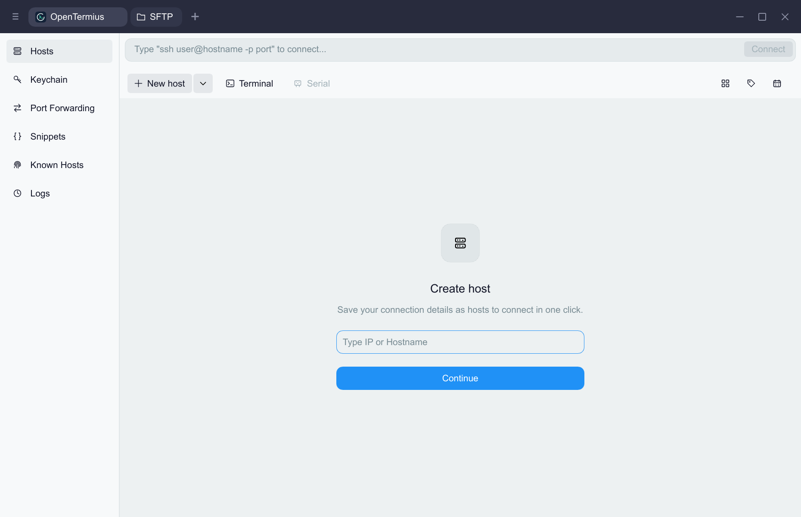

<p align="center"></p>

<h1 align="center">OpenTermius</h1>

<p align="center">A lightweight, local-first SSH &amp; SFTP client.<br>Built with Rust and Slint. No account required.</p>

## English

OpenTermius brings host management, SSH terminals and SFTP file transfers into one native workspace. It stores configuration locally and requires no product account, subscription, cloud sync or telemetry. Windows x64 is a validated preview with an installer. macOS and Linux build and pass the full test suite in GitHub Actions CI, but have not yet been hand-tested on real desktops.

The interface uses English, with Simplified Chinese available in **Settings → Appearance → Language**. Choose **English**, **简体中文**, or **System**. System is the persisted default: it uses Chinese when the Windows UI language is Chinese (or `LANG` starts with `zh` on other platforms), otherwise English. Changes apply immediately to labels, messages and page models. Server responses, terminal output, file names and user-created labels retain their original text. All translations are bundled; no translation service is contacted.

Features include saved hosts and groups, SSH password/private-key/interactive authentication, host fingerprint verification, local terminals, multiple terminal tabs, SFTP transfers, key management, port forwarding, snippets, connection history and encrypted backup/restore. Credentials are encrypted locally with Windows DPAPI, or AES-256-GCM with a platform-specific master key on macOS/Linux. Host JSON exports omit credentials and trust records.

For development, run `cargo build --locked` and `cargo test --locked` **inside `native/`**. Rust/Slint sources live in `native/src/` and `native/ui/`; the Rust message catalog is `native/src/i18n_catalog.rs`, and bundled Slint translations are in `native/translations/zh_CN/LC_MESSAGES/opentermius-ui.po` (named for the UI crate). Add English source keys and Chinese translations together. Localization tests check catalog coverage and placeholder parity. Installer languages are configured separately.

Windows localization screenshots: [English main window](docs/screenshots/i18n-en-main.png), [English Settings](docs/screenshots/i18n-en-settings.png), [Chinese main window](docs/screenshots/i18n-zh-main.png), [Chinese Settings](docs/screenshots/i18n-zh-settings.png).

## 中文

OpenTermius 面向 **Windows、macOS 和 Linux** 打造轻量原生终端体验，将主机管理、远程会话和文件传输放在同一个工作区。连接信息保存在本机，无需注册产品账号，没有云同步、订阅或遥测服务。

在 **设置 → 外观 → 语言** 中选择 English、简体中文或跟随系统，即时切换界面语言。默认跟随系统：Windows 界面语言为中文时使用简体中文，其他情况使用英文；非 Windows 读取 `LANG`。服务器响应、终端输出、文件名与用户输入保留原文，翻译完全离线。

| 平台 | 当前状态 |
| --- | --- |
| Windows x64 | 可运行的预览版本，已验证 |
| macOS | GitHub Actions CI（macos-latest）构建与全部测试通过；尚未经真机手工验证 |
| Linux | GitHub Actions CI（ubuntu-latest）构建与全部测试通过；尚未经真机手工验证 |



## 当前功能

- 主机创建与编辑、搜索、分组筛选和 JSON 导入/导出。
- SSH 密码、私钥及交互式认证；首次连接确认 SHA-256 指纹，指纹变化时拒绝连接。
- 多标签终端、Unicode/ANSI 输出、窗口尺寸同步、历史滚动和复制粘贴。
- 本地终端：Windows 使用 ConPTY/PowerShell；macOS/Linux 使用 PTY 和用户的 `$SHELL` 登录 shell。
- SFTP 双栏文件浏览、流式上传与下载；上传覆盖需确认，下载不覆盖已有文件。
- 加密保存密码和密钥口令：Windows DPAPI；macOS Keychain 主密钥 + AES-256-GCM；Linux 本地主密钥 + AES-256-GCM。主机导出不含凭据或信任记录。

## 安装

Windows 安装程序：`native/releases/OpenTermius-<version>-windows-x64-setup.exe`。双击安装，默认按当前用户安装到 `%LOCALAPPDATA%\Programs\OpenTermius`，无需管理员权限。安装程序提供开始菜单快捷方式，并可选择创建桌面快捷方式；安装或覆盖升级前会检查 OpenTermius 是否正在运行。

卸载会删除程序文件和快捷方式，但默认保留 `%APPDATA%\OpenTermius` 中的配置。如需一并删除主机、凭据和偏好设置，请在卸载界面勾选“同时删除我的数据”。

配置保存在系统配置目录的 `OpenTermius/opentermius-native.json`。升级时可自动读取旧版本的本地配置，不覆盖已有的新配置。程序目前未配置发布者签名，构建产物不提交到源码仓库。

## 开发

本机验证环境为 Windows x64、Rust 1.97.1 MSVC、Slint 1.18.1，需要 Visual Studio C++ Build Tools。macOS 需要 Xcode Command Line Tools；Linux 的系统开发依赖见 `.github/workflows/ci.yml`。首次获取依赖需要网络，应用运行时不依赖网络服务（SSH/SFTP 连接除外）。

```powershell
cd native
cargo run --locked
cargo test --locked
cargo build --release --locked
```

请在 `native/` 内执行 Cargo，以加载该目录配置。默认使用宿主目标；Windows x64 MSVC 继续使用静态 CRT。默认产物位于 `target/debug` / `target/release`（Windows 带 `.exe`）；显式 `--target` 构建则位于 `target/<triple>/...`，`CARGO_TARGET_DIR` 可覆盖根目录。

工作区将 Slint 生成代码单独放在 `opentermius-ui` 中，`.slint` 源文件仍在 `native/ui/`。集成测试统一从 `native/tests/all/main.rs` 加载；新增测试文件后须在该入口声明模块。筛选测试使用 `cargo test --locked --test all transport::` 等模块前缀。测速方法及开发编译选项见 [编译速度记录](docs/build-speed.md)。

Linux 需安装 X11/Wayland、fontconfig、xkbcommon 和等宽字体；文件对话框需要 XDG desktop portal 及桌面环境对应的 portal backend。终端字体为 Windows Cascadia Mono（未安装时 Consolas）、macOS Menlo、Linux DejaVu Sans Mono，度量与渲染共享同一字体。

macOS 将随机 256 位主密钥保存为默认 Keychain 的 generic password，钥匙串锁定或拒绝访问时保存凭据会失败。Linux 为避免引入额外 Secret Service 依赖，使用配置目录下当前用户拥有、权限为 `0600` 的 `master-key-v1` 文件；配置目录不可由其他用户写入。**Linux 主密钥文件未由系统钥匙串加密**，无法防御已能读取当前用户文件的攻击者。备份配置时应安全备份该文件；丢失主密钥后无法恢复已保存的密码。非 Windows 凭据带 `v1:` 前缀，不支持直接解密其他机器/平台的已有凭据；Windows 原始 DPAPI 格式保持兼容。`--data-dir` 同时隔离便携加密主密钥。

在仓库根目录打包 Windows 安装程序及 SHA-256 清单：

```powershell
./native/scripts/package.ps1
```

产物为 `native/releases/OpenTermius-<version>-windows-x64-setup.exe` 和 `native/releases/checksums.json`，不再生成便携 exe。打包需要 NSIS 3；脚本会从 `-MakensisPath`、`PATH`、标准安装目录或 `%LOCALAPPDATA%\electron-builder\Cache\nsis` 查找 `makensis.exe`。未安装时可执行：

```powershell
winget install -e --id NSIS.NSIS --accept-source-agreements --accept-package-agreements
```

安装程序验证会将安装目录设为独立临时目录，静默安装、检查快捷方式和 HKCU 卸载项，再静默卸载并确认用户配置保留：

```powershell
./native/installer/verify-install.ps1
```

在对应宿主系统运行 `bash native/scripts/package-macos.sh` 或 `bash native/scripts/package-linux.sh`，输出到 `native/releases/`。macOS 脚本使用 `sips` + `iconutil` 将已提交的 PNG 转换为 ICNS，生成 `.app` 和 `hdiutil` DMG；缺少图标工具时使用系统默认图标，未签名/公证。Linux 脚本生成含二进制、`.desktop`、PNG 图标及安装说明的 tar.gz，不捆绑系统动态库。两个脚本支持 `CARGO_BUILD_TARGET`、`CARGO_TARGET_DIR` 和 `OPENTERMIUS_TEST_EXECUTABLE`。尚未在对应系统执行打包脚本。

实际 GUI 集成测试需交互式 Windows 桌面，使用临时 SSH/SFTP 服务及隔离配置：

```powershell
cd native
$env:OPENTERMIUS_TEST_EXECUTABLE = (Resolve-Path target/release/opentermius.exe).Path
$env:OPENTERMIUS_SMOKE_OUTPUT = Join-Path (Get-Location) 'test-output/release-live'
cargo test --locked --test all transport::native_gui_live_selftest -- --ignored --nocapture
```

## 自动构建

[Windows installer 工作流](.github/workflows/windows-release.yml) 在推送到 `main`、向 `main` 提交 PR、推送 `v*` 标签时运行，也可在 GitHub Actions 中通过 **Run workflow** 手动触发。工作流使用 Windows runner 和 Rust stable，依次运行锁定依赖的测试、release 构建及 NSIS 打包；需要交互式桌面的 GUI 测试保持忽略。

构建成功后，在该次运行的 **Artifacts** 中下载 `OpenTermius-windows-x64-setup`，内含 `OpenTermius-<version>-windows-x64-setup.exe` 和 `checksums.json`。推送与 `native/Cargo.toml` 版本一致的 `vX.Y.Z` 标签还会自动创建 GitHub Release，附上这两个文件并在发布说明中列出 SHA-256；版本不一致会直接失败。安装程序尚未签名，Windows SmartScreen 可能提示警告，可使用 `Get-FileHash <安装程序路径> -Algorithm SHA256` 核对清单中的哈希值。

## 设计与实现

界面由 Slint 直接渲染，使用系统字体和项目绘制的 SVG 图标。应用标识源文件为 [assets/logo.svg](assets/logo.svg)，Windows 程序内嵌多尺寸图标及 OpenTermius 版本信息。修改标识后，可使用 ImageMagick 执行 `./scripts/generate-icons.ps1` 重新生成 PNG/ICO；正常构建无需 ImageMagick。

SSH/SFTP 使用 russh 与 russh-sftp，终端屏幕使用 vt100，异步任务由 Tokio 调度。应用不需要 Electron、Chromium、WebView 或 Node.js 运行时。

实现细节见 [架构文档](docs/architecture.md)，本次适配验证见 [跨平台验证记录](docs/cross-platform-validation.md)，历史 Windows 发布产物验证见 [validation.json](docs/validation.json)。

## 开发状态

当前是预览版本，已包含密钥管理、端口转发、代码片段、已知主机、连接日志、偏好设置及恢复码备份。尚未提供 Mosh、串口、Telnet、FIDO2 或证书认证。终端支持输入法，但尚未覆盖全部 xterm 行为及长期压力场景；macOS/Linux 真机验证仍待完成。
