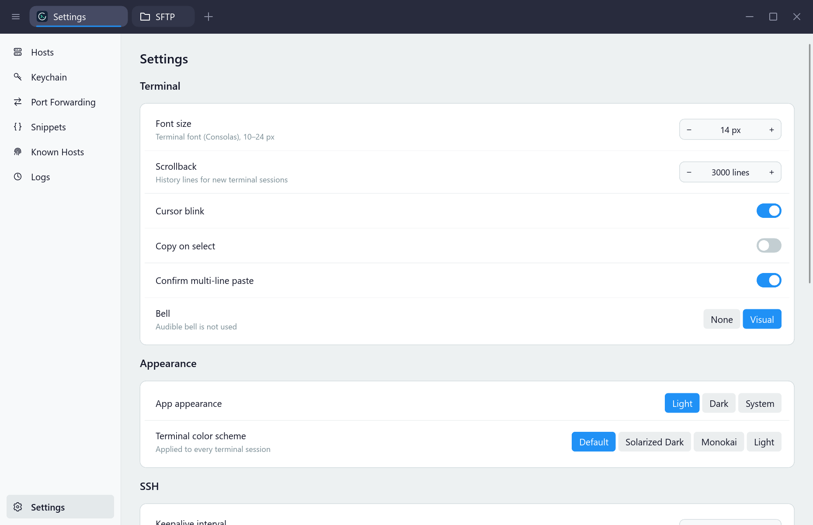

# 编译速度（第二轮）

## 实现

- `native/` 改为 Cargo 工作区，根包、应用名和 `target/debug|release/opentermius.exe` 路径不变。`ui-crate/` 中的 `opentermius-ui` 单独编译并导出 Slint 窗口、桥接全局和模型；`.slint` 与图标仍在 `native/ui/`，根 `build.rs` 只保留 Windows 图标和版本资源。
- `src/main.rs` 通过一次导入保持所有页面现有的 `crate::AppWindow` 等引用。修改应用或页面 Rust 文件时，Cargo 复用已经编译的 UI。
- 17 个集成测试模块统一由 `tests/all/main.rs` 加载，显式声明 `[[test]] name = "all"` 并关闭自动发现。原有 280 项通过测试、4 项 ignored 测试均保留；库、应用单元测试仍单独运行。迁移只修改设计测试的相对资源路径，没有新增业务行为或业务测试。
- 生成代码包没有自己的测试或文档示例，关闭其空的 unit/doc-test target，避免 `cargo test --workspace` 再编译一份完整 UI；它仍作为应用和集成测试的依赖正常编译、验证。
- UI 工作区成员显式设置 dev `debug = false`；依赖通配设置不会覆盖工作区成员。应用自身继续保留行号信息，release 与 release-fast 配置均未修改。
- README、验证技能、历史文档中的可执行命令以及 CI 已更新为工作区和合并后的测试入口。

## 方法与环境

2026-10-20，Windows 10 x64 19045，Intel i7-11700（16 逻辑处理器）、64 GB 内存、Rust 1.97.1 MSVC、Slint 1.18.1，`CARGO_BUILD_JOBS=4`，静态 CRT。基线源码为 `3d0c031`。始终在 `native/` 内通过 PATH 上的 Cargo 队列运行，复用本工作树的 `native/target`，没有清理 target、删除锁文件或终止其他进程。

先预热 `cargo build --locked` 和测试编译，再逐项运行三次，取**墙钟时间最小值**。A–D 只更新时间戳，不改文件内容：

| 场景 | 操作 |
| --- | --- |
| A | touch `src/main.rs`，`cargo build --locked` |
| B | touch `src/pages/settings.rs`，`cargo build --locked` |
| C | touch `ui/main.slint`，`cargo build --locked` |
| D | touch `src/store.rs`，`cargo test --locked --no-run` |
| E | 所有测试已编译且文件未改变，`cargo test --locked` |

通过 `Get-Counter '\Processor(_Total)\% Processor Time'` 在运行期间约每秒采样。下表的 CPU 是各次运行平均值的范围；这些测量中未出现持续高 CPU 负载，未把预热计入最小值。墙钟时间包含 Cargo 启动、机器级队列、文件锁和链接等待，不能解释为纯编译器耗时。RSA 测试的随机密钥生成、共享机器与文件缓存会造成波动，三次最小值不是耗时保证，也不是冷构建测试。

## 前后结果

最终默认配置采用独立 UI、合并测试和 UI dev `debug = false`，继续使用默认 MSVC 链接器。

| 场景 | 基线最小值（秒） | 最终最小值（秒） | 变化 |
| --- | ---: | ---: | --- |
| A：应用 Rust | 14.589 | 5.075 | 减少 65.2%，约 2.9 倍快 |
| B：页面 Rust | 14.947 | 4.666 | 减少 68.8%，约 3.2 倍快 |
| C：Slint | 21.416 | 22.818 | 增加 6.5% |
| D：存储改动后编译测试 | 38.551 | 10.182 | 减少 73.6%，约 3.8 倍快 |
| E：未改动的完整测试 | 26.113 | 12.872 | 减少 50.7%，约 2.0 倍快 |

Slint 改动仍需重建生成代码和应用，默认编译路径没有消除这项成本；本轮主要收益来自 Rust 改动不再重编译生成代码，以及减少独立测试的编译、链接和启动次数。

| 版本 / 场景 | 三次墙钟时间（秒） | 三次平均 CPU 范围 |
| --- | --- | --- |
| 基线 A | 14.589 / 14.829 / 18.695 | 15.8–19.9% |
| 基线 B | 16.173 / 16.598 / 14.947 | 18.1–21.7% |
| 基线 C | 22.021 / 21.416 / 21.505 | 14.6–20.6% |
| 基线 D | 44.484 / 38.551 / 48.076 | 16.7–30.2% |
| 基线 E | 46.791 / 26.113 / 31.087 | 15.6–27.1% |
| 最终 A | 5.254 / 5.075 / 5.984 | 16.4–18.1% |
| 最终 B | 4.813 / 5.718 / 4.666 | 16.5–18.8% |
| 最终 C | 22.818 / 25.075 / 26.304 | 16.5–18.8% |
| 最终 D | 10.513 / 10.693 / 10.182 | 24.7–25.4% |
| 最终 E | 22.681 / 15.463 / 12.872 | 23.6–29.0% |

## 参数试验与取舍

每行 A/B/C 均取三次最小值，单位为秒：

| 配置 | A | B | C | 处理 |
| --- | ---: | ---: | ---: | --- |
| 仅拆分 UI，生成代码保留行号 | 4.715 | 5.441 | 24.740 | 中间对照 |
| UI `debug = false` | 5.075 | 4.666 | 22.818 | 保留；C 减少 7.8%，UI rlib 从 324,804,468 降至 258,476,838 字节 |
| 再设 UI `codegen-units = 16` | 4.989 | 4.642 | 22.813 | 未见有意义的 A/B/C 收益，撤销 |
| UI 无调试信息，应用使用 bundled rust-lld | 4.152 | 4.387 | 21.404 | 保留可选开发命令，不改全局链接器 |

LLVM 链接器只通过 `cargo rustc` 替换最终应用的链接步骤，避免为试验重编译全部依赖。稳定 Rust 需要 `linker-flavor=lld-link`，并指定工具链根 `bin/rust-lld.exe`；不用需要 nightly 的 `msvc-lld` 名称。可在 Windows 的 `native/` 内执行：

```powershell
$lld = Join-Path (rustc --print sysroot) 'lib/rustlib/x86_64-pc-windows-msvc/bin/rust-lld.exe'
cargo rustc --locked --bin opentermius -- -C "linker=$lld" -C linker-flavor=lld-link
```

未引入没有测量支持的依赖 `opt-level`、其他 codegen 或 split-debuginfo 改动；发布链接器和 `[profile.release]` 保持不变。

## 可选 Slint 实时预览

本机 registry 中 Slint 1.18.1 的 `live-preview` feature 启用 `i-slint-live-preview/live-component`。仅开启依赖 feature 不足以生成实时版本，还要在 **UI 构建脚本进程内**设置 `SLINT_LIVE_PREVIEW=1`。`opentermius-ui` 的 feature 同时完成这两步，不污染调用 shell 或集成测试中的 `slint!` 宏。

```powershell
# 在 native/ 内；首次会额外编译 Slint 解释器和文件监听依赖。
cargo run --locked --features live-preview
```

这条开发路径读取原位置的 `.slint` 文件；布局、文本和样式改动可在运行时重载。修改导出的 Rust 类型、属性或回调签名仍需重新编译。该 feature 默认关闭，不用于正常发布，不增加默认程序的解释器或监听依赖。锁文件包含 Slint 此可选功能的传递依赖，没有另选第三方热更新框架。

## 复现与记录

```powershell
cd native
./scripts/measure-build.ps1 -Label local
./scripts/measure-build.ps1 -Label local-lld -Scenarios A,B,C -Lld
```

脚本的每轮输出在 `native/test-output/build-speed/<label>-<timestamp>/`，包括 `results.json`、CPU 逐秒采样 `cpu.csv` 和逐命令日志。CPU 负载高或排队明显时再次执行，不更换 target 目录。提交中的 [测量记录](build-speed-measurements.json) 保留基线及各参数试验的时间、采样数量和 CPU 汇总；完整本地构建日志和产物不进入 Git。

本轮数据仅适用于此 Windows 主机及上述 touch 场景；没有据此声称 macOS/Linux、全新依赖构建或真实大幅 Slint 改动具有相同比例的收益。

## 最终验证

| 检查 | 结果 |
| --- | --- |
| `cargo build --locked` | 退出码 0，零警告 |
| `cargo test --locked` | 94 项库测试 + 17 项应用测试 + 169 项集成测试通过，4 项桌面测试按设计 ignored；零警告 |
| `cargo test --workspace --locked` | 同样 280 项通过、4 项 ignored，零警告；不再构建生成代码包的空测试程序 |
| `cargo build --locked --features live-preview` | 退出码 0，零警告；额外依赖首次编译用时 40.99 秒，Settings 场景启动成功 |
| `cargo build --release --locked` | 退出码 0，零警告；本机此轮依赖和新 UI 包的 release 构建共 6 分 39 秒，不属于上表的增量基准 |
| release 可执行文件 + 合并后的 ignored 测试入口 | 顺序执行 4 项全部通过：密码转发自启动与清理、密钥转发自启动与清理、真实 SFTP 界面、真实 SSH/SFTP/凭据界面 |
| release `--smoke-scene=section-settings` | `ok=true`；1860×1200 原生截图已查看，图标、字体、控件和滚动布局正常；与 live-preview 场景图逐字节一致 |
| `./native/scripts/package.ps1 -SkipBuild`（指定本机缓存 NSIS 与 dumpbin 路径） | 生成安装程序及 `checksums.json`；产品身份正确，DLL 导入检查无 VC runtime |
| `./native/installer/verify-install.ps1` | 安装、覆盖安装、快捷方式及注册表检查、卸载、清理全部通过，正常卸载保留配置 |

release 桌面验证命令在 `native/` 内执行，使用 debug 测试驱动验证实际 release 程序：

```powershell
$env:OPENTERMIUS_TEST_EXECUTABLE = (Resolve-Path target/release/opentermius.exe).Path
cargo test --locked --test all -- --ignored --nocapture --test-threads=1
```

本轮安装程序 `native/releases/OpenTermius-0.2.0-windows-x64-setup.exe` 为 7,810,205 字节，SHA-256 为 `c51c4e644f544eac63da10f3b2a5209da4319c58405f116410c3890c53a4ad91`。安装程序、校验清单及完整日志保留在本工作树的忽略目录中。


